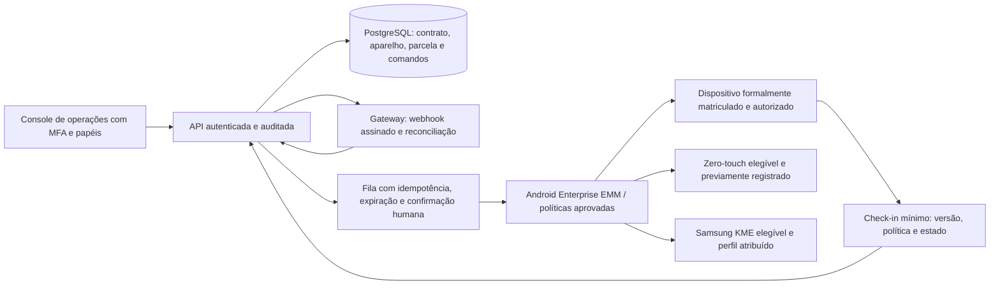

# Auditoria técnica — ALNTECH CELL

**Data:** 5 de novembro de 2026  
**Escopo observado:** repositório local `alntech-cell`, páginas institucionais, catálogo, assistência, rastreamento demonstrativo, funções Netlify para checkout e conferência InfinitePay.  
**Tipo:** revisão estática de código e arquitetura. Não houve teste de carga, Lighthouse/PageSpeed, transação, varredura externa, validação de conta comercial nem auditoria jurídica.

## Resultado executivo

O projeto é uma boa base de apresentação e protótipo. Ainda não é uma loja ou plataforma de assistência pronta para operar com clientes: produtos, preços e ordens são demonstrativos, os formulários guardam dados no navegador local, não há painel administrativo nem banco de dados, e a confirmação de pagamento não está ligada a uma ordem persistente. O checkout permanece corretamente bloqueado por configuração.

**Decisão recomendada:** publicar apenas como apresentação/protótipo com os avisos atuais. Não anunciar venda, receber pedidos de assistência ou tratar o retorno de pagamento como quitação operacional até concluir os itens P0/P1 abaixo. O endereço `alntechcell.io` precisa estar registrado e apontado por DNS antes de ser associado ao Netlify.

## Escopo que existe no código

- **Início:** página institucional e navegação entre views no mesmo HTML.
- **Loja:** seis produtos e preços embutidos em `app.js`, explicitamente demonstrativos. Carrinho no `localStorage`.
- **Serviços:** categorias gerais de diagnóstico, componentes, bateria/carga e configuração oficial de software.
- **Solicitar reparo:** formulário de demonstração; nome, telefone, modelo e descrição ficam apenas no `localStorage` daquele navegador.
- **Acompanhar:** consulta local, usando dados do mesmo navegador; o status é editável pelo próprio usuário do protótipo. Não existe ordem central.
- **Pagamento:** função serverless cria link com catálogo do ambiente Netlify e a página de retorno consulta a InfinitePay. A chave fica no servidor. `CHECKOUT_ENABLED` permanece `false` por padrão.
- **Conta, carteira e Supabase:** não existem neste repositório. A transcrição anexada os menciona, mas não comprova integração nem deve ser tratada como instrução executável.
- **Android DPC/MDM/device lock:** não existe código, app Android, backend de gestão ou integração Zero-touch/Knox neste repositório.

## Achados por prioridade

| Prioridade | Achado | Efeito | Recomendação |
|---|---|---|---|
| P0 | Catálogo, preço, estoque, entrega, entidade comercial e contato reais não foram fornecidos | A página ainda não pode representar uma oferta pronta para compra | Substituir todos os dados demonstrativos e revisar condições, estoque e operação antes de abrir o checkout |
| P0 | Checkout está sem chave/variáveis reais e bloqueado por padrão | Pagamento indisponível, intencionalmente | Manter desligado até configurar segredo no Netlify, catálogo validado e URL de produção; a chave Pix não substitui a API key |
| P0 | Não há persistência central de pedidos, usuários ou ordens de serviço | Perda de dados entre dispositivos; sem painel da loja, conciliação ou atendimento confiável | Criar backend autenticado e banco com trilha de auditoria; não usar `localStorage` como sistema operacional da loja |
| P1 | `payment-check` apenas consulta status e retorna valores; não existe pedido persistido nem comparação com total esperado | O retorno do navegador não deve liberar produto, saldo, licença ou aparelho | Persistir pedido e total no servidor; validar valor/moeda/estado; processar webhook assinado ou reconciliação server-to-server idempotente; creditar uma única vez |
| P1 | A criação de checkout é acessível por função pública e a verificação de `Origin` é contornável por chamadas não-browser | Um atacante pode automatizar links permitidos e gerar ruído/custo operacional | Rate limit no edge/backend, limites por pedido/IP, logs sem dados sensíveis, monitoramento, idempotência e proteção anti-abuso. `Origin` ajuda CORS, mas não autentica cliente |
| P1 | Formulário local solicita telefone e descrição de defeito mesmo sem envio à loja | Pode induzir o consumidor a inserir dado pessoal em dispositivo compartilhado; o telefone e problema permanecem no navegador | Antes de coletar dados reais, publicar aviso de privacidade, finalidade, retenção, contato do controlador e mecanismo de direitos; coletar apenas o necessário |
| P1 | Não há políticas comerciais/privacidade/garantia/devolução, identificação completa do fornecedor ou canais reais confirmados | Lacuna de confiança e informação para venda/assistência | Publicar páginas e condições revisadas pela pessoa responsável e assessoria adequada; preencher identificação, atendimento, orçamento, prazos e pós-venda |
| P2 | Testemunhos/avaliações ou indicadores de confiança não verificados foram removidos da versão atual; ainda há frases genéricas de marketing | Confirmar todas as afirmações factuais e não prometer qualidade/disponibilidade sem evidência | Manter claims verificáveis e substituir texto genérico por informação comercial concreta |
| P2 | Painel de ordens e status ficam no cliente e são livremente alteráveis | Demonstração não segura para operação | Remover ações administrativas da área pública; exigir autenticação, autorização por papel e registro de alterações no servidor |
| P2 | A interface não implementa gestão de foco completa para gaveta do carrinho e fluxos de teclado | Pode prejudicar teclado e leitores de tela | Definir diálogo semântico, prender/restaurar foco, mensagens acessíveis e validar contraste/teclado em desktop e celular |
| P2 | Fontes vêm de terceiro | Dependência externa e possível atraso/transferência de metadados de conexão | Usar fontes de sistema ou hospedar fontes licenciadas localmente; acompanhar peso e carregamento |

### Correção aplicada nesta revisão

- Normalização dos dados do carrinho ao ler `localStorage`: somente IDs conhecidos e quantidades inteiras limitadas são aceitos.
- Escape de ID e status das ordens ao renderizar a lista local, além dos campos já escapados.
- Cabeçalhos CSP, HSTS, proteção contra MIME sniffing e framing, política de referência e bloqueio de câmera/microfone/localização no `netlify.toml`.
- Remoção do `@import` de fontes do CSS; preconnect e `display=swap` declarados no HTML para reduzir a cadeia de carregamento.

Esses ajustes reduzem riscos do protótipo; não transformam o armazenamento local em backend seguro.

## Proposta de arquitetura para Android Enterprise / gestão de aparelhos

O requisito colado propõe um DPC proprietário para travar telefones financiados. Isso é uma mudança de produto de alto impacto, separada do site atual. O texto pede coleta de dados sensíveis e, ao mesmo tempo, diz que o escopo não deve monitorá-los: a especificação precisa escolher minimização estrita. A proposta segura abaixo **não** inclui vigilância, ocultação do app, bypass de reset ou bloqueio coercitivo de telefone pessoal.

### Limites técnicos e de produto

1. **Device Owner não é uma permissão comum de aplicativo.** O aparelho precisa ser provisionado como totalmente gerenciado por processo suportado. Lock task é um modo de quiosque com pacotes explicitamente permitidos; não é uma simples janela que “sobrepõe qualquer app”. Deve-se testar versão de Android, fabricante, telefonia, chamadas de emergência, acessibilidade e recuperação.
2. **Factory reset não reinstala um APK por mágica.** Android zero-touch requer aparelho elegível e atribuído por canal autorizado; no reset, o fluxo oficial reaplica configuração e instala/aciona o DPC/EMM previsto. KME depende de aparelhos Samsung elegíveis, cadastro/upload e perfil de enrollment atribuído. Sem elegibilidade e registro prévio do dispositivo, não há persistência garantida.
3. **A finalidade original do Zero-touch/KME é provisionamento de dispositivos corporativos/gerenciados.** Não presumir que um EMM customizado de financiamento será aceito pelo Google, Samsung, revendedor ou fabricante; validar programa, contratos, licenças e termos antes de escolher stack.
4. **Política de inadimplência precisa de revisão jurídica antes de qualquer controle técnico.** Prever notificação, período de cura, contestação, confirmação inequívoca da dívida, desbloqueio automático após pagamento, rota de suporte, exceções de emergência e auditoria. Evitar bloquear chamadas essenciais, acesso a dados pessoais, ou impedir resolução de disputa. O CDC veda constrangimento ou ameaça na cobrança; o desenho não pode converter cobrança em coerção.
5. **Minimização LGPD:** não coletar fotos, mensagens, contatos, histórico de navegação ou localização. Guardar somente identificadores estritamente necessários, vínculo contratual, status de parcela, estado mínimo da política e trilha de comando. Definir base legal, transparência, acesso, correção, retenção, eliminação quando cabível, resposta a incidentes e contratos com operadores.
6. **Comandos remotos:** FCM deve ser sinal de despertar, nunca a fonte de verdade nem conter dados do cliente. Buscar comando autenticado do servidor, com ID único, prazo, estado, razão codificada e trilha imutável. Confirmar resultado e manter recuperação manual; exigir dupla aprovação para ações de alto impacto.
7. **Pagamentos:** webhook validado, ledger de eventos idempotente e conciliação do valor/moeda com a parcela. Nunca confiar no `redirect_url`, no JavaScript do cliente ou só no `payment_check` para alterar contrato ou liberar equipamento.

### Stack sugerida

- **Site e checkout:** frontend estático no Netlify; funções Node.js para operações públicas de baixa complexidade; API própria para operações autenticadas, se crescer.
- **Dados:** PostgreSQL gerenciado; políticas de acesso do banco e segregação de papéis; backups testados. Supabase pode ser considerado para Auth/Postgres, mas só com RLS correta e sem chave `service_role` no navegador.
- **Console e API:** TypeScript/Node.js, OpenAPI, autenticação OIDC/MFA para equipe, RBAC e logs de auditoria.
- **Android:** preferir Android Management API/EMM compatível se o modelo e os termos permitirem; DPC próprio em Kotlin somente se houver equipe Android Enterprise e validação formal do programa.
- **Mensageria:** fila gerenciada com retry e dead-letter; FCM só como notificação de sincronização.
- **Observabilidade:** logs estruturados com redaction, alertas de pagamento/comando atrasado, métricas de disponibilidade e trilha de incidentes.

## Qualidade e desempenho

O site é estático, sem framework pesado e sem imagens remotas no caminho principal; isso é favorável. A fonte externa era importada dentro do CSS e foi movida para preconnect/stylesheet separado. O tamanho do CSS é o maior recurso local, mas a principal oportunidade não é minificá-lo: é medir no dispositivo real, remover conteúdo e estilos não usados se crescer, e consolidar assets com versão/caching apropriado.

**Não há nota Lighthouse ou Core Web Vitals medida nesta auditoria.** Para a fase de lançamento, medir em celular mediano e rede móvel, e acompanhar p75 de campo. Metas de boa experiência usadas como critério: LCP ≤ 2,5 s, INP ≤ 200 ms e CLS ≤ 0,1 no percentil 75, segmentado por mobile/desktop. Evitar declarar “premium/max” sem esse resultado observado.

## Fases e estimativa inicial

Estimativa de ordem de grandeza; depende de acesso aos programas Google/Samsung, gateway, catálogo e decisão jurídica.

| Fase | Entregas | Faixa |
|---|---|---:|
| 0. Descoberta e validação | catálogo/empresa, fluxo comercial, elegibilidade dos aparelhos, modelo de consentimento e regras de cobrança | 24–40 h |
| 1. Loja pública | páginas legais/comerciais, catálogo real, domínio/DNS, acessibilidade e desempenho medido | 32–56 h |
| 2. Pedidos e pagamento | backend, banco, webhook, conciliação idempotente, painel básico, testes de falha | 60–100 h |
| 3. Protótipo Android Enterprise | prova técnica em aparelhos de teste próprios, enrollment gerenciado, política mínima e recuperação | 80–140 h |
| 4. Piloto controlado | segurança, privacidade, suporte, runbooks, teste de rede/reset/pagamento e aprovação de operação | 40–80 h |

**Total indicativo:** 236–416 horas (aprox. 6–11 semanas de uma pessoa em tempo integral), sem contar atrasos de habilitação de fornecedor, revisão jurídica, licenças, certificações, compra de aparelhos ou produção de conteúdo. Não inclui app de vigilância nem bypass de proteção do fabricante.

## Critérios de pronto para comercialização

- Dados comerciais reais, inventário/entrega, preço final e responsável publicados.
- Páginas de privacidade, termos, garantia, troca/devolução, atendimento e orçamento revisadas.
- Ordem de serviço criada no backend, acesso autenticado e privacidade entre clientes verificada.
- Checkout só com catálogo de produção e chave privada no Netlify; webhook e conciliação idempotentes; alertas e reembolsos descritos.
- Domínio registrado, DNS/TLS validados, deploy ligado ao repositório e rollback praticado.
- Revisão de segurança, acessibilidade, dispositivos móveis e Core Web Vitals medida; política de retenção e incidentes pronta.
- Para gestão Android: elegibilidade e autorização documental, enrollment em hardware de teste, desbloqueio/saída e recuperação comprovados antes do piloto; revisão jurídica documentada.

## Referências primárias

- [Android Enterprise — dispositivos dedicados e restrições](https://developer.android.com/work/dpc/dedicated-devices/cookbook)
- [Android Enterprise — Lock task mode](https://developer.android.com/work/dpc/dedicated-devices/lock-task-mode)
- [Google — provisionamento e Zero-touch](https://developers.google.com/android/management/provision-device)
- [Google Zero-touch — como funciona e elegibilidade pelo canal de revenda](https://developers.google.com/zero-touch/guides/how-it-works)
- [Samsung Knox — completar enrollment KME após configuração/reset](https://docs.samsungknox.com/admin/knox-mobile-enrollment/how-to-guides/enroll-devices/complete-device-enrollment/)
- [Samsung Knox — enrollment via KME](https://docs.samsungknox.com/admin/knox-manage/configure/devices/enroll-devices/enroll-devices-in-bulk/use-samsung-knox-mobile-enrollment/)
- [Código de Defesa do Consumidor, art. 42](https://www.planalto.gov.br/ccivil_03/leis/l8078compilado.htm)
- [Governo Federal — princípios da LGPD](https://www.gov.br/saude/pt-br/acesso-a-informacao/lgpd/principios)
- [web.dev — limites atuais de Core Web Vitals](https://web.dev/articles/vitals)
